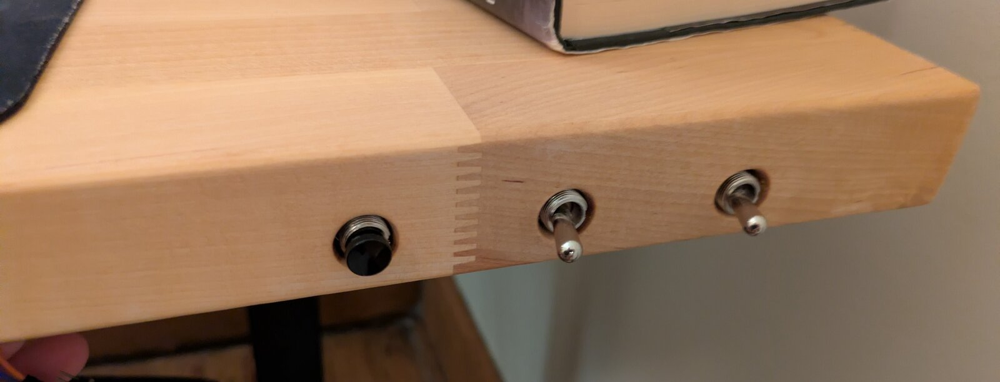
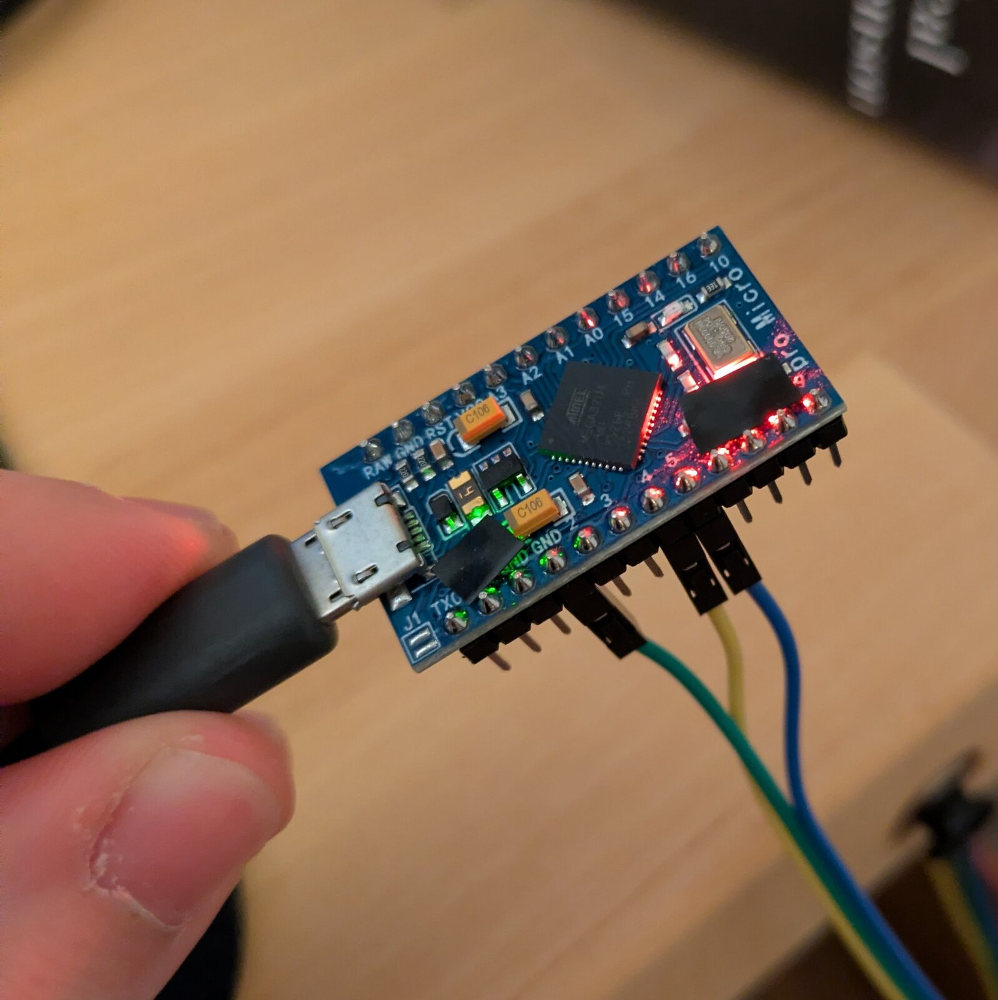
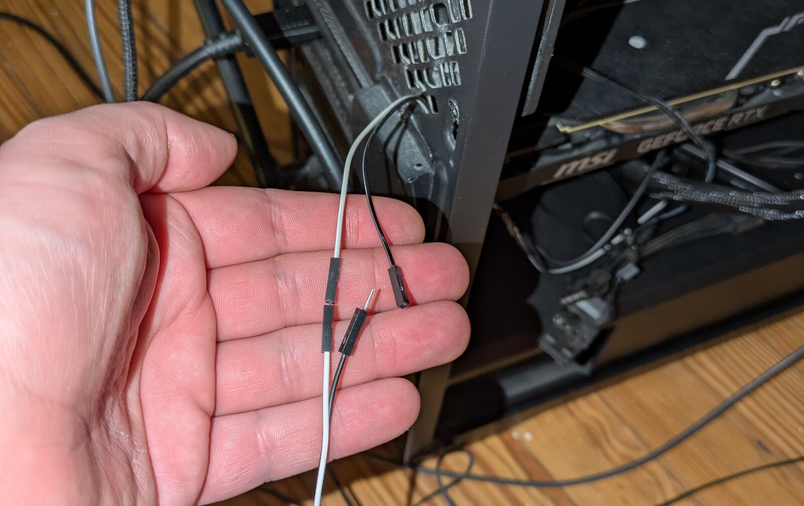
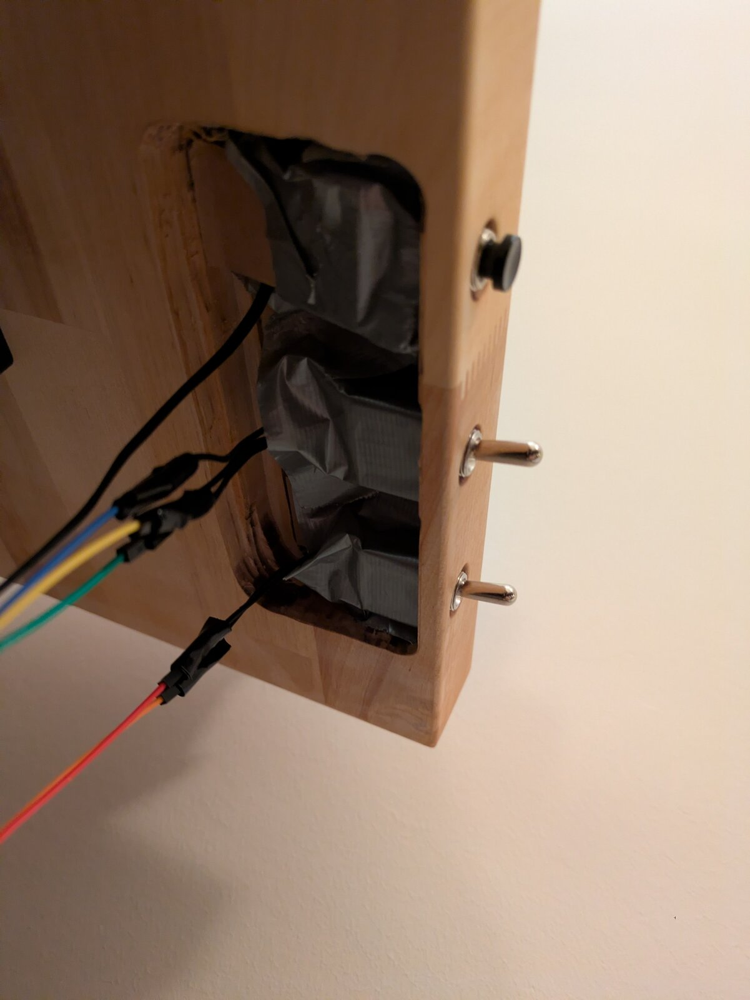

# Hardware boot switch for a Linux and Windows dual boot

A three-position toggle switch picks which operating system the PC boots:

| Switch | What happens at power-on |
|---|---|
| Linux side | Boots Linux straight away. No menu. |
| Middle | Shows the GRUB menu and waits, with no countdown. |
| Windows side | Boots Windows straight away. No menu. |
| Board unplugged | Your normal GRUB menu, exactly as before. |

It works on a cold boot and on a restart from either OS. Flip the switch, click Restart, and the PC comes back up in the other system. Next to the switch is a power button wired to the motherboard, so the whole thing can live on (or in) the desk.



*The power button and the boot switch, set into the front edge of the desk. The second toggle switch is a separate project and isn't covered here.*

## How it works

The switch is wired to a **Pro Micro**, a small microcontroller board. It runs custom firmware that makes the board look like a tiny read-only USB drive. The drive holds one empty file, and its name follows the switch: `LINUX.SW`, `WINDOWS.SW` or `MENU.SW`. Nothing is stored. The firmware builds the drive's contents on the fly every time something reads it, so the file always matches the switch.

GRUB can already read FAT drives, so it needs no new modules. A short script added to the GRUB config looks for the drive and checks which file is there:

```
if search --no-floppy --fs-uuid --set=hwsw B007-5317; then
  if [ -f ($hwsw)/linux.sw ]; then
    set default="<your Linux entry>"
    set timeout=0
  elif [ -f ($hwsw)/windows.sw ]; then
    set default="<your Windows entry>"
    set timeout=0
  else
    set timeout=-1          # middle: wait for a choice
  fi
fi
```

If the board isn't plugged in, the search fails, the block does nothing, and GRUB behaves exactly as it did before. A broken or missing board can never stop the PC from booting.

## What you need

**Parts**

| Part | Notes |
|---|---|
| Pro Micro, 5 V / 16 MHz (ATmega32U4) | I used [this one from Micro Center](https://community.microcenter.com/kb/articles/653-pro-micro-5v-16mhz-development-board). The [SparkFun original](https://www.sparkfun.com/products/12640) and most clones also work. A clone with a different bootloader should still flash; see [Flashing](#1-flash-the-board). The 3.3 V / 8 MHz version needs `F_CPU = 8000000` in `firmware/makefile` and a rebuild. |
| ON-OFF-ON toggle switch | Three positions with a true centre-off. I used a standard one from Home Depot. An ON-ON switch has no middle position. |
| Momentary push button, normally open | For power. A *latching* button would hold the motherboard's power pins closed and force a shutdown after about 4 seconds. |
| Dupont jumper wires | Male-to-male, male-to-female and female-to-female. They let you take everything apart without unsoldering. |
| 2-pin Dupont Y splitter | So the case's own power button keeps working. |
| Micro-USB cable | It must be a data cable, not a charge-only one. |
| Heat shrink or electrical tape | |

**Tools:** soldering iron, a multimeter with a continuity beep, and a router or drill if you're setting the switches into a desk.

**Software**

- A UEFI PC that boots through **GRUB 2**, with Windows already listed in the GRUB menu and booting from it. Tested with GRUB 2.16 on EndeavourOS (Arch).
- To flash the board: `avrdude`. To build the firmware yourself, also `avr-gcc` and `avr-libc`:
  - Arch: `sudo pacman -S avr-gcc avr-libc avrdude`
  - Debian/Ubuntu: `sudo apt install gcc-avr avr-libc avrdude`
  - A prebuilt `prebuilt/bootswitch.hex` is included if you'd rather not build.

## Before you start

- **BitLocker.** If Windows uses BitLocker, starting Windows from GRUB instead of from the firmware boot menu can make it ask for the recovery key. Have the key ready, or check that choosing Windows from your GRUB menu already works without asking.
- **Make sure GRUB can boot Windows.** If Windows isn't in your GRUB menu yet, fix that first. On most distributions, set `GRUB_DISABLE_OS_PROBER=false` in `/etc/default/grub`, install `os-prober` and regenerate the config. The switch only picks between entries that already work.
- **Secure Boot** was off on the tested machine. The GRUB commands used are allowed under Secure Boot, but this hasn't been tested.

## 1. Flash the board

```
git clone --recursive https://github.com/conormarco/grub-boot-switch.git
cd grub-boot-switch
```

`--recursive` also fetches [LUFA](https://github.com/abcminiuser/lufa), the USB library the firmware is built on. If you already cloned without it, run `git submodule update --init`.

Build it (optional; skip this to use the prebuilt file):

```
make -C firmware
```

Plug the Pro Micro in by USB and flash it:

```
sudo ./scripts/flash-firmware.sh
```

The script finds the board by its USB ID, restarts it into its bootloader and writes the firmware. If it says the bootloader didn't appear, briefly connect the board's `RST` pin to `GND` twice in quick succession, then run the script again within 8 seconds.

When it finishes, `lsusb` lists a device with the ID `03eb:2068`.

**Test it before soldering anything.** Run:

```
sudo ./scripts/watch-switch.sh
```

It should say `Menu (middle)`. Touch a piece of wire between pin `4` and `GND`, and it changes to `Linux`. Pin `5` to `GND` gives `Windows`. Press Ctrl+C to stop.

## 2. Wire the switch

| Switch terminal | Pro Micro pin |
|---|---|
| Middle (common) | `GND` (either one) |
| One outer terminal | `4` |
| Other outer terminal | `5` |

No resistors are needed. The firmware turns on the chip's internal pull-ups, so each pin reads high until the switch connects it to ground.

Check your switch with a multimeter before soldering, because not every switch puts the common terminal in the middle. In each end position, the common terminal should beep to one outer terminal. In the middle position, nothing should beep. If your switch has six terminals, it's a double switch: use one row of three and ignore the other.

Don't solder the switch straight to the board. Put Dupont connectors in between, so the electronics come apart easily and the wires stay soldered to the switches:

- Solder a short lead to each switch terminal, ending in a male Dupont pin, and insulate the joints.
- Female-to-male jumper wires carry the connection from there to the board.
- The female ends push onto the Pro Micro's header pins.



*The leads push onto the Pro Micro's header pins, so the board can be unplugged and reused.*

**Lever backwards?** If Linux is on the side you wanted for Windows, swap the wires on pins 4 and 5.

Wrap the Pro Micro or put it in a small case so the pins can't touch anything metal.

## 3. Wire the power button

A PC's power button is just a momentary switch across two pins on the motherboard's front-panel header. Briefly shorting them is a press. A second button in parallel works exactly like the first one, and either one turns the PC on or off.

1. Find the power switch pins in your motherboard manual. They're on the front-panel header, often called `JFP1` or `F_PANEL`, and labelled `PWR_SW`, `PW+`/`PW-` or `POWER SW`. Polarity doesn't matter for a switch.
2. Pull the case's power button connector off those two pins.
3. Plug the Y splitter onto the pins, and plug the case's button into one branch.
4. Run Dupont extension leads from the other branch out of the case. I threaded them through a gap in the case.
5. Solder two leads to the new button's terminals and plug them into the extension leads.



*The power button's extension leads leave the case through a gap in the back panel. The joins between leads are plain Dupont connectors.*

Test it before mounting anything. With the PC off, a press of the new button should start it.

## 4. Mount the switches

I set both into the front edge of my desk:

- **Pocket:** cut it from underneath with a hand router, leaving only a thin front wall for the switches to mount through.
- **Underside:** it can be as rough as you like, because nobody sees it.
- **Front face:** take your time here. It's the only part on show, and the switch's nut and washer have to cover the edge of the hole.
- **Insulation:** tape over the backs of the switches stops the bare terminals from touching each other or the wiring.



*The pocket from underneath. Tape covers the switch terminals, and the Dupont joins hang below so everything unplugs.*

## 5. Plug the board into the PC

Use a USB port on the **back of the motherboard** itself, not a front-panel port or a hub. GRUB relies on the firmware to set up USB, and the rear ports are the most likely to be ready that early. I used a USB 2.0 port. Leave the board in the same port from now on.

## 6. Add the switch to GRUB

GRUB picks an entry by its ID, which is specific to your install. The installer finds the IDs for you. First, see what it will find:

```
sudo ./scripts/install-grub.sh --list
```

This prints each top-level menu entry with its ID and changes nothing. The installer chooses:

- **Linux:** the first entry, normally your distribution's default.
- **Windows:** the entry that starts `bootmgfw.efi`, the Windows Boot Manager.

If those are right, install:

```
sudo ./scripts/install-grub.sh
```

To choose different entries, pass their IDs from the list:

```
sudo ./scripts/install-grub.sh --linux-id 'gnulinux-simple-…' --windows-id 'osprober-efi-…'
```

The installer:

1. backs up `grub.cfg` to `/root`;
2. writes `/etc/grub.d/06_hwswitch` with your two IDs filled in;
3. regenerates `grub.cfg`;
4. checks that the switch block and both IDs are in the new file. If anything is missing, it restores the backup.

It also warns you if a later script in your setup sets `timeout` or `default` again, which could override the switch. Some Ubuntu setups do this when the menu is hidden.

Because the script lives in `/etc/grub.d`, it survives kernel and GRUB updates. The entry IDs don't change when the kernel is updated.

**Fedora and other BootLoaderSpec systems:** the installer can't detect the IDs there. It tells you what to pass instead.

## 7. Test it

Test each case once:

| Test | Expect |
|---|---|
| Switch on Linux, shut down, power on | Straight to Linux |
| Switch on Windows, restart from Linux | Straight to Windows |
| Switch on Linux, restart from Windows | Straight to Linux. This is the important one: Windows can leave USB in a different state. |
| Switch on Windows, shut down, power on | Straight to Windows |
| Switch in the middle, restart | Menu with no countdown; it waits until you choose |
| Board unplugged, restart | Your normal menu and countdown |

If something goes wrong, set the switch to the middle and restart to get the menu. Unplugging the board gives you the normal menu.

Windows shows the board as a small read-only drive called `BOOTSWITCH`. It's harmless, and Windows can't write to it.

## Optional: udev rule

```
sudo install -m 0644 udev/70-bootswitch.rules /etc/udev/rules.d/
sudo udevadm control --reload && sudo udevadm trigger
```

The rule stops the desktop from offering to mount the board's drive. It also lets `watch-switch.sh` run without sudo, and gives the board's serial port the name `/dev/bootswitch`.

## Troubleshooting

**The switch is ignored and the normal menu appears.** GRUB can't see the board. Check these:

- The board is in a rear motherboard port.
- If your BIOS has **Fast Boot**, or a USB setting that only partly sets up USB at power-on, turn it off.
- At the GRUB menu, press `c` and run:

  ```
  search --no-floppy --fs-uuid --set=x B007-5317
  echo $x
  ```

  If nothing prints, GRUB can't see the board. Try another rear port.

**It always shows the menu, even with the switch to one side.** The middle position also shows the menu, and so does having both sides grounded. Run `watch-switch.sh` and check the wiring with a multimeter.

**It boots the wrong system.** Run `sudo ./scripts/install-grub.sh --list`, then reinstall with the right `--linux-id`/`--windows-id`.

**Windows asks for the BitLocker recovery key.** See [Before you start](#before-you-start). After entering the key once, suspending and resuming BitLocker in Windows usually makes it accept the new boot path.

**To remove it:**

```
sudo rm /etc/grub.d/06_hwswitch
sudo grub-mkconfig -o /boot/grub/grub.cfg
```

## How the firmware works

The firmware in `firmware/` is built on LUFA's VirtualSerialMassStorage demo. The board presents two USB functions:

**A read-only USB drive.** It's a 1 MB disk with an MBR and one FAT12 partition, whose volume ID is `B007-5317`.
- No storage chip is involved. `virtualdisk.c` builds each 512-byte block when the PC asks for it, and only the root folder block depends on the switch.
- Writes are refused, and the disk reports itself as write-protected.
- Pins are read on every request, so a disk read always returns the switch's current position.

**A USB serial port.** It prints `BOOT=LINUX`, `BOOT=WINDOWS` or `BOOT=MENU` when the port is opened and whenever the switch moves.
- For example: `cat /dev/bootswitch` with the udev rule installed.
- Opening the port at 1200 baud and closing it restarts the board into its bootloader, the same as an Arduino. That's how `flash-firmware.sh` reflashes it without pressing reset.

`firmware/test/make_image.c` writes the same disk image to a file, so you can check it on the PC with `fsck.fat` or `grub-fstest`.

**USB ID.** The firmware uses LUFA's demo USB ID, `03eb:2068`. That's fine for a personal build. If you make these for other people, get your own ID, for example free from [pid.codes](https://pid.codes) for open hardware.

## Licence

MIT, see [LICENSE](LICENSE). Parts of the firmware come from LUFA by Dean Camera and keep LUFA's own permissive licence, which is also in that file.
